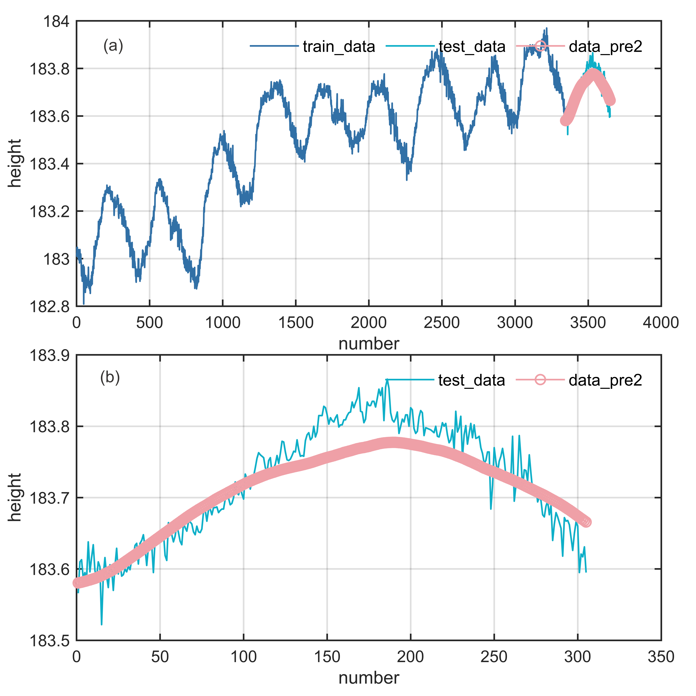

# MATLAB | Time Series Forecasting | ARIMA Forecast Model | Included data and plotting code | Directly Implementable

ARIMA (Autoregressive Integrated Moving Average) model is a predictive model based on time series analysis, suitable for analyzing and predicting data with both time-dependent and stochastic characteristics. The ARIMA model was first proposed by Box and Jenkins in 1976 and has become a widely used time series model for forecasting data in production and finance sectors. The core idea of the ARIMA model is to differenciate the time series data to make it stationary, then establish the model through the combination of autoregression (AR) and moving average (MA), and use this model for prediction. In the ARIMA model, "AR" stands for autoregression, indicating that the current data is related to the data from several previous moments; "I" stands for differenciation, meaning to differenciate the data to make it stationary; "MA" stands for moving average, indicating that the current data is related to the errors from several previous moments.
The establishment process of the ARIMA model includes three steps: model identification, parameter estimation, and model verification. In the model identification stage, the order of the ARIMA model and the number of differenciations need to be determined; in the parameter estimation stage, the model needs to be estimated; in the model verification stage, the model needs to be verified and judged whether the prediction accuracy meets the requirements.
The advantages of the ARIMA model are that it can fully utilize the historical information of time series data for prediction, can adapt to various types of time series data, and has good explanatory power. However, there are some disadvantages to the ARIMA model, such as the need to differenciate non-stationary time series data, and the process of parameter estimation is relatively complex.
Attached video tutorial operation:
\n        \n          \n          \n          \n          \n            To view this video please enable JavaScript, and consider upgrading to a\n            web browser that\n            supports HTML5 video\n  

## Images

<!-- PAYMENT_BLOCK -->

## Get this dataset

- Payment link (Stripe): [Buy now](https://buy.stripe.com/3cs8yP7sY87d0vu9AB)
- Payment QR code: 

<!-- /PAYMENT_BLOCK -->
